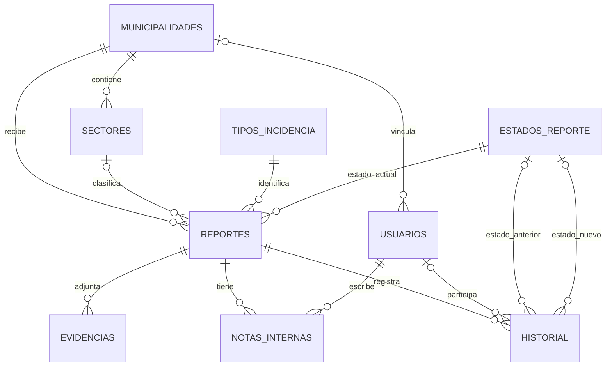

# Modelo de relaciones — AlertaBarrio

Diseño lógico propuesto para PostgreSQL; no crea tablas ni modifica la aplicación. Campos y tipos en [el diccionario](diccionario-datos.md); acuerdos en [datos y permisos](diseno-datos-permisos.md).

## Lectura del modelo

| Relación | Regla |
|---|---|
| Municipalidad y sectores | Piloto Yungay: sólo sectores atendidos por esa municipalidad. Catálogo ampliable sin nombres ni cantidades inventados; no se incluyen otras comunas. |
| Municipalidad y usuarios | Muni requiere municipalidad; Admin no tiene una asignación restrictiva. Una cuenta Muni inicial y una Admin aparte, con posibilidad de crecer. |
| Municipalidad y reportes | Cada reporte tiene municipalidad receptora obligatoria; su comuna se obtiene de ese registro. No se necesita tabla adicional de comunas o coberturas para este piloto. |
| Sector y reportes | Cero o un sector por reporte, siempre de la misma municipalidad. Dejarlo pendiente si no se reconoce es una propuesta técnica para permitir el envío y clasificar después. |
| Tipo, estado y reportes | Un tipo y un estado actual obligatorios por reporte. Estado inicial Nuevo. |
| Reporte y evidencias | Un reporte puede tener cero o varios archivos. Cada archivo pertenece a un reporte. |
| Reporte y notas | Cero o muchas notas internas, cada una con funcionario autor y fecha. |
| Reporte e historial | Eventos sucesivos; se propone guardar recepción y cambios relevantes. La autoría puede ser usuario, envío anónimo o sistema. |
| Estado e historial | Dos referencias opcionales distintas, anterior y nuevo; no sustituyen el estado actual del reporte. |

## Reglas transversales

- Envío anónimo, sin entidad de reportante ni campos de identidad, contacto o nombreOculto. Los registros técnicos del servidor requieren una decisión aparte.
- Admin accede a todo. Muni accede a su municipalidad, incluida VIF, ubicación y evidencia. VIF se destaca visualmente; no se infiere una prioridad automática.
- Dirección o referencia cercana, coordenadas válidas o ambas. La dirección manual permite reportar sin GPS. Precisión real del dispositivo separada del círculo visual aproximado de 20 m; no se garantiza esa exactitud.
- Recepción generada en servidor con `timestamptz` y mostrada en `America/Santiago`. La hora del hecho distinta va en observaciones; no es un campo adicional obligatorio.
- Estados exactos: **Nuevo**, **Abierto**, **En curso**, **Cerrado**, **No concluido**. No concluido es distinto de Cerrado y no se cuenta como resuelto. Transiciones, reapertura y reglas de cierre no están definidas.
- Los informes semanales, mensuales y trimestrales consultarán los reportes individuales por `recibido_en`. No hay tablas por período; anual postergado.

## Propuestas y pendientes

Son propuestas técnicas: UUID, nombres y tipos de campos, sector pendiente, notas sucesivas y representación de autoría del historial. Ninguna es una función ya implementada.

Quedan por fijar antes del piloto operativo los sectores de la carga inicial, reglas de prioridad y estados, formatos/límites de adjuntos y conservación. No bloquean el diseño básico ni se consideran aprobados por figurar aquí.
